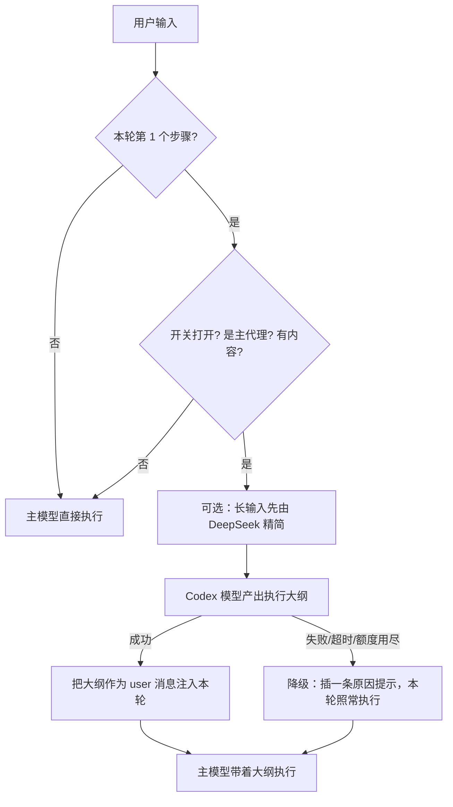

# dsh-plan-mode

[](https://github.com/hojoc26/dsh-plan-mode/actions/workflows/ci.yml)
[](LICENSE)
[](https://github.com/hojoc26/dsh-plan-mode#readme)

给 **DSH（DeepSeek Harness）** 用的「先规划、再执行」插件。

打开开关后，每一轮任务的第一个步骤之前，先用一个 **GPT / Codex 模型**（默认走 `openai-codex`，花 ChatGPT 订阅额度而不是主模型额度）把你这轮要做的事拆成一份执行大纲，再把大纲作为一条持久上下文注入本轮，交给主模型（DeepSeek）照着执行。

一句话：**让便宜的模型干活，让强的模型先想清楚。**

---

## 它解决什么问题

主模型直接开干，常见三种翻车：

- 方向想歪了，写了两百行代码才发现理解错需求；
- 该先确认的事没确认，做到一半回头返工；
- 长任务没有验收标准，自己觉得做完了，其实漏了一半。

这个插件在动手前插入一次「规划」，把上面三件事钉下来：步骤、开工前必须确认的约束、验收标准、主要风险。规划只花一次调用，但省下的返工往往更多。

## 工作流程



- 每轮只规划**一次**（只在 `step === 1`），不会每步都调。
- 任何失败都**降级**，不会让一轮任务挂掉。
- **子代理不规划**，委派时不会成倍烧额度。
- 走 `ctx.llm.stream()` 直连，**不切换**主会话模型，也不会递归触发自己。

## 功能特性

| | |
|---|---|
| 一次性开关 | 输入框右侧、模型选择器旁的「规划」胶囊，灰色=关 / 蓝色=开 |
| 状态持久化 | 存在 `~/.dsh/plan-mode.json`（尊重 `DSH_HOME`），重启后保留 |
| 两类输出格式 | 问答类给「结论+依据+不确定处」；动手类给「步骤+约束+验收+风险」 |
| 长输入精简 | 超过阈值先用便宜模型压一遍再送规划器，省 token、提准确率 |
| 附件理解 | `.docx/.xlsx/.pptx/.pdf` 提取正文，图片直接转给规划器 |
| 中文友好 | 自建 CJK 感知的 token 估算，不会被 `4 字符/token` 低估 |
| 可诊断 | 三条本机回环路由，能单独测规划、测附件提取、看 build 标记 |
| 零依赖 | 不需要打包器、不需要 `npm install`，DSH 的模块加载器直接跑 |

## 环境要求

- DSH（DeepSeek Harness）桌面版，含 Web GUI（插件含浏览器半侧，`platform: web`）。
- 一个已注册在 DSH 里的 provider：
  - 规划器：默认 `openai-codex` + `gpt-6.1-sol`（需要先装 `dsh-codex-connect` 之类的 Codex 连接插件并登录）；
  - 精简器：默认 `deepseek-account` + `deepseek-flash`。
  - 两者都可以改成你已有的任意 provider / model，见[配置](#配置)。
- 附件里的 Office/PDF 提取需要 Python（优先用 DSH 自带运行时，找不到再退回 `python`）。纯文本和图片不需要。

## 安装

插件不在 npm 上，从本仓库安装。**核心只有一件事**：把 `package.json` 和 `lib/` 放进 profile 的 `node_modules/dsh-plan-mode`，再在 `cordis.patch.yml` 里插入一条配置。

### 方式 A：脚本安装（推荐）

```powershell
git clone https://github.com/hojoc26/dsh-plan-mode.git "$env:TEMP\dsh-plan-mode"
powershell -ExecutionPolicy Bypass -File "$env:TEMP\dsh-plan-mode\scripts\install.ps1"
```

脚本会：复制文件到 `~/.dsh/profiles/desktop/node_modules/dsh-plan-mode`、检查 `cordis.patch.yml` 里有没有 `plan-mode` 条目，没有就打印可直接粘贴的片段。脚本是幂等的，重跑不会覆盖你的配置。

参数：

```powershell
# 装到别的 profile
powershell -ExecutionPolicy Bypass -File .\scripts\install.ps1 -Profile "$env:USERPROFILE\.dsh\profiles\other"

# 只复制文件，不打印配置片段
powershell -ExecutionPolicy Bypass -File .\scripts\install.ps1 -Quiet
```

Windows PowerShell 5.1 和 PowerShell 7（`pwsh`）都能跑；用 7 时把 `powershell -ExecutionPolicy Bypass -File` 换成 `pwsh -File` 即可。如果 `git` 没装，也可以用方式 B、C，或者直接从仓库页面的 **Code → Download ZIP** 拿源码。

macOS / Linux：

```bash
git clone https://github.com/hojoc26/dsh-plan-mode.git /tmp/dsh-plan-mode
bash /tmp/dsh-plan-mode/scripts/install.sh
```

### 方式 B：手动复制

```powershell
$src = "C:\path\to\dsh-plan-mode"
$dst = "$env:USERPROFILE\.dsh\profiles\desktop\node_modules\dsh-plan-mode"

New-Item -ItemType Directory -Force -Path $dst | Out-Null
Copy-Item "$src\package.json" $dst -Force
Remove-Item "$dst\lib" -Recurse -Force -ErrorAction SilentlyContinue
Copy-Item "$src\lib" "$dst\lib" -Recurse -Force
```

### 方式 C：用 Release 里的 zip

下载 `dsh-plan-mode-0.4.1.zip`，解压后让 `package.json` 与 `lib/` 落在
`~/.dsh/profiles/desktop/node_modules/dsh-plan-mode/` 下即可，无需构建。

### 加配置

编辑 `~/.dsh/profiles/desktop/cordis.patch.yml`，在末尾追加（完整示例见 [`examples/cordis.patch.yml`](examples/cordis.patch.yml)）：

```yaml
- insert:
    - id: plan-mode
      name: 'dsh-plan-mode'
      config:
        provider: openai-codex
        model: gpt-6.1-sol
        reasoningEffort: high
        maxTokens: 10000
        timeoutMs: 180000
```

然后让 profile 重新加载（重启 DSH，或改动 `cordis.patch.yml` 触发热重载），**并刷新浏览器页面**——浏览器半侧不会随宿主热重载自动更新。

### 验证装好了

1. 输入框右侧、模型选择器旁出现「规划」胶囊 → 浏览器半侧已加载。
2. 打开浏览器的网络面板，或直接访问当前 Web GUI 端口：

   ```powershell
   curl.exe http://127.0.0.1:<端口>/plugins/dsh-plan-mode/state
   # {"enabled":false,"build":"0.4.1"}
   ```

   `build` 与 `package.json` 的 `version` 一致，说明宿主半侧也加载了。

## 使用

1. 点「规划」胶囊，变蓝 = 开。
2. 正常提需求。
3. 主模型开始干活之前，对话里会出现一条以 `【规划阶段 · 由 ... 生成】` 开头的消息，就是大纲。
4. 不满意就关掉开关重发；只对某几个任务生效就随手开关，状态是全局的。

> 全局生效（所有会话、所有工作区）。想做「每会话独立」，把 `~/.dsh/plan-mode.json` 的状态改成按 `sessionId` 存即可。

## 配置

所有配置写在 `cordis.patch.yml` 的 `config` 里，未写的键用默认值。

| 键 | 默认值 | 说明 |
|---|---|---|
| `provider` | `openai-codex` | 规划器 provider，必须是已注册的 |
| `model` | `gpt-6.1-sol` | 规划器模型，换成 `gpt-6-astra` 等亦可 |
| `reasoningEffort` | `high` | 透传给适配器；留空字符串表示不传 |
| `maxTokens` | `10000` | 大纲输出上限 |
| `timeoutMs` | `180000` | 规划请求超时 |
| `minChars` | `0` | 输入短于此长度跳过规划；`0` = 只要有内容就规划 |
| `notifyOnFailure` | `true` | 规划失败时是否在对话里插一条原因提示 |
| `condense.*` | 见下 | 长输入精简 |
| `attachments.*` | 见下 | 附件提取 |

`condense`（精简，默认开）：

| 键 | 默认值 | 说明 |
|---|---|---|
| `enabled` | `true` | 总开关 |
| `provider` / `model` | `deepseek-account` / `deepseek-flash` | 用便宜模型压输入 |
| `minTokens` | `8000` | 估算超过此值才精简；未超过则原文直送，零额外调用 |
| `maxChars` | `6000` | 精简结果上限 |
| `maxInputChars` | `60000` | 精简请求自身的输入上限（超出截断） |
| `maxTokens` | `1200` | 精简输出上限 |
| `timeoutMs` | `60000` | 精简超时 |

`attachments`（附件，默认开）：

| 键 | 默认值 | 说明 |
|---|---|---|
| `enabled` | `true` | 总开关 |
| `images` | `true` | 图片作为图像块转给规划器；模型拒收时自动回退纯文本重试一次 |
| `maxChars` | `30000` | 单个附件提取上限 |
| `timeoutMs` | `30000` | 单个附件提取超时 |
| `pythonPath` | `''` | 留空自动用 DSH 自带 python，找不到则用 `python` |

更细的说明和常见配法见 [`docs/configuration.md`](docs/configuration.md)。

## 附件支持

| 类型 | 方式 |
|---|---|
| `.md/.txt/.json/.csv/.log/.js/.ts/.py/...` | 直接读，按字符上限截断 |
| `.docx` | python-docx：段落 + 表格（表格行内用竖线分隔） |
| `.xlsx` | openpyxl：每个工作表、前 500 行 |
| `.pptx` | python-pptx：每张 slide 的文本 |
| `.pdf` | pypdf：逐页文本层 |
| 图片 | 作为 image 块转给规划器；拒收则退回纯文本 |

提取失败一律降级成一行引用 + 原因，不会中断规划。带附件时，规划器还会额外输出「附件解构」和「还原方案」两段。

## 它会怎么规划

- **问答/确认类**：给「结论 + 依据 + 不确定处」，200 字以内，不列步骤、不反问。
- **动手/交付类**：一句话任务类型 + 3–8 个编号步骤（做什么 → 产出什么）+ 开工前约束 + 验收标准 + 1–3 个风险。

提示词写在 `lib/index.js` 的 `SYSTEM_PROMPT` 里，想改直接改常量（改完记得同步到 profile 并刷新页面）。

## 诊断接口

三条路由都只绑定在本机回环地址上，与 DSH Web 处于同一信任边界：

```powershell
# 开关状态 + build 标记
curl.exe http://127.0.0.1:<端口>/plugins/dsh-plan-mode/state

# 用一次固定任务试跑规划器，不影响任何会话
curl.exe -X POST http://127.0.0.1:<端口>/plugins/dsh-plan-mode/selftest -H "content-type: application/json" -d '{\"task\":\"帮我做一个周报模板\"}'

# 顺带验证附件提取（只读，最多 8 个路径）
curl.exe -X POST http://127.0.0.1:<端口>/plugins/dsh-plan-mode/selftest -H "content-type: application/json" -d '{\"paths\":[\"C:/tmp/report.docx\"]}'

# 当前代理树，用来确认「子代理不规划」的判断
curl.exe http://127.0.0.1:<端口>/plugins/dsh-plan-mode/agents
```

`selftest` 返回 `ok / ms / tokens / request / text`，能直接看出用的是哪个 provider、哪个 model、花了多久。目前没有鉴权，**不要把这个端口暴露到公网**。

## 开发与测试

没有构建步骤：`lib/index.js` 是宿主半侧（ESM，由 DSH 直接 import），`lib/client.js` 是浏览器半侧（一段手写的模块加载调用，React 由 shell 的共享模块表提供）。

```powershell
npm test          # = node --test，跑冒烟测试，不需要安装任何依赖
node --check lib/index.js
node --check lib/client.js
```

改完源码同步到运行副本（脚本会做这件事）：

```powershell
pwsh -File .\scripts\install.ps1
```

宿主半侧随 profile 热重载生效；浏览器半侧需要刷新页面。验证是否真的换上了新代码：看 `/plugins/dsh-plan-mode/state` 返回的 `build`。

目录结构：

```
lib/index.js        宿主半侧：pre-step 钩子、三条路由、附件提取、精简
lib/client.js       浏览器半侧：「规划」胶囊与状态读写
test/smoke.test.mjs 冒烟测试（不依赖 DSH）
docs/               配置、原理、排错
scripts/            安装脚本（Windows / POSIX）
examples/           可直接粘贴的 cordis.patch.yml 片段
```

## 升级

```powershell
git -C "$env:TEMP\dsh-plan-mode" pull
pwsh -File "$env:TEMP\dsh-plan-mode\scripts\install.ps1"
```

然后硬刷新页面（`Ctrl+Shift+R`），确认 `build` 变了。

## 卸载

1. 删掉 `cordis.patch.yml` 里 `id: plan-mode` 那段 `insert`；
2. 删掉 `~/.dsh/profiles/desktop/node_modules/dsh-plan-mode` 目录；
3. 可选：删掉 `~/.dsh/plan-mode.json`；
4. 刷新页面。

## 已知边界

- **规划器看不到工作区**：它只是一次纯文本模型调用，不会读代码、不会列目录。需要「先读代码再规划」时，应改用子代理版本。
- **大纲会进历史**：它是一条 `user` 消息，会出现在对话记录里，也会被后续压缩当作历史处理。
- **每轮多一次调用**：首 token 前多几秒。长任务值得，闲聊不值得，用 `minChars` 挡掉。
- **不做 HTTP 鉴权**：路由只绑在本机回环地址，与 DSH Web 同样的信任边界。
- **状态是全局的**：一个开关管所有会话。

## 相关文档

- [配置详解](docs/configuration.md)
- [工作原理](docs/how-it-works.md)
- [排错](docs/troubleshooting.md)
- [更新日志](CHANGELOG.md)
- [安全说明](SECURITY.md)

## 许可证

[MIT](LICENSE) © 2026 hojoc26
