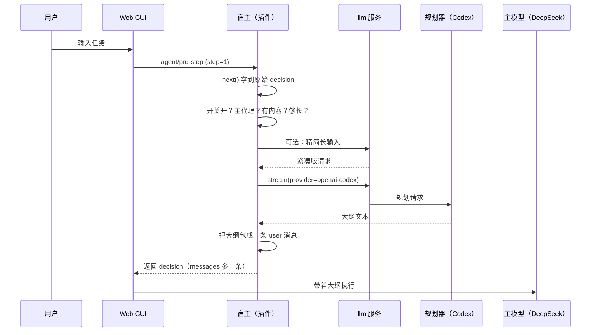

# 工作原理

这个插件由两半组成，部署在同一个包里：

| | 文件 | 运行环境 | 干什么 |
|---|---|---|---|
| 宿主半侧 | `lib/index.js` | DSH 主进程（Node ESM） | 挂钩子、调模型、读附件、开路由 |
| 浏览器半侧 | `lib/client.js` | Web GUI（浏览器） | 画「规划」胶囊、读写开关状态 |

两半之间**没有共享内存**，只通过一条 HTTP 路由通信。所以宿主重载后浏览器必须刷新，否则旧页面还在用旧状态。

## 一次规划的生命周期



### 钩子契约

```js
ctx.on('agent/pre-step', async (payload, next) => {
  const decision = await next()
  // decision.kind === 'enter' 表示这一步真的要进循环
  // payload.step === 1       表示是本轮第一个步骤
  // payload.agent            是本步所属的代理
  return { ...decision, messages: [...decision.messages, outlineMessage] }
})
```

关键点：

- **先 `await next()`**，拿到原始 decision，再决定要不要加东西。任何我们自己抛的错都在外层 `try` 里被吞掉，返回原始 decision —— 也就是「失败即放行」。
- 只改 `decision.messages`，**不动**其他字段，所以权限、模型路由、工具集都不受影响。
- 注入的消息标了 `source: { kind: 'plan-mode' }`，既方便排查，也让它不会被插件自己当成「用户输入」再规划一次（`readTask` 只认 `source.kind === 'user'`，或是没有 `source` 的消息）。

### 为什么不会递归

用的是 `ctx.llm.stream(...)` 直连模型适配器，**不经过 agent 循环**：

- 不产生新的 `agent/pre-step` 事件，所以不会自我触发；
- 不改会话路由的模型，主模型还是你选的那个；
- 不进对话历史（除了最后注入的那条大纲）。

### 为什么子代理不规划

`isRootAgent()` 用 `ctx.agents.roots()` 判断当前 `payload.agent` 是不是根代理。委派出去的子代理每步都会触发 `pre-step`，逐个规划会成倍烧额度，而且子代理的 prompt 通常是主模型自己写的，规划收益不大。

比较代理用的是 `id` 相等，不用引用相等 —— 注册表内部是否复用对象是实现细节。

## 输入是怎么筛出来的

DSH 会在每轮塞进一堆 `role: 'user'` 的消息：运行时上下文、技能目录、时间戳、记忆。如果只看 `role`，规划器会收到几 KB 的系统文本，既浪费 token 又误导规划。

所以规则是：**只统计 `source.kind === 'user'` 的文本块**（或是没有 `source` 的历史消息）。由此两个直接结果：

- 「你亲手输入的长度」= 规划器看到的长度；
- 系统注入的内容既不参与长度判断，也不会被送进规划器。

## 附件流水线

```
attachment block
  ├─ type: 'image' → 作为 image 块转给规划器
  │                   └─ 模型拒收？→ 去掉图片、加一行说明，重试一次
  └─ 其他           → ctx.get('attachments').fileHostPath(ref) 找到落盘副本
                       ├─ 文本扩展名 → 直接读
                       └─ Office/PDF → spawn Python 提取脚本
```

- 提取结果**不参与精简**，因为精简恰恰会压掉「表格几行几列、slide 几张、字段叫什么」这类规划最需要的信息。
- 任何一步失败都只产出一行「[文件附件] 名字（类型，字节数）+ 失败原因」，不让整轮规划失败。

## 三条路由

都注册在 DSH 的 `webServer` 上，`kind: 'exact'`，跟随 Web GUI 的端口：

| 路由 | 方法 | 作用 |
|---|---|---|
| `/plugins/dsh-plan-mode/state` | GET / POST | 读 / 写开关；GET 顺便返回 `build` |
| `/plugins/dsh-plan-mode/selftest` | POST | 用固定或指定的任务试跑一遍规划器，不碰任何会话 |
| `/plugins/dsh-plan-mode/agents` | GET | 打印代理树，确认根代理判断 |

`selftest` 存在的原因：规划失败在正常流程里是「静默降级」的，只看对话很难判断到底是超时、401 还是额度用尽。这个接口把 `ok / ms / tokens / request / text / error` 全吐出来。

它还支持 `paths` 参数，可以对任意绝对路径跑一次提取，用来单独验证附件链路（只读、最多 8 个路径、有长度上限）。

## 状态文件

`~/.dsh/plan-mode.json`（有 `DSH_HOME` 时以它为准）：

```json
{ "enabled": false }
```

读失败当作「关」，写失败只 warn 不抛 —— 开关状态不值得让一轮任务失败。

## 安全边界

- 没有鉴权，也没有 `CORS` 头。信任边界与 DSH Web 相同：**只绑本机回环地址，不要暴露到公网**。
- 跨站请求因为 `content-type: application/json` 会触发预检，而服务端不响应 `OPTIONS`，浏览器侧会被拦下。
- 插件不读取任何 API key：鉴权全部由 DSH 的 provider 层负责，配置里只出现 provider / model 名字。
- 唯一会读任意路径的入口是 `selftest` 的 `paths` 参数，只读、有上限、仅本机。
